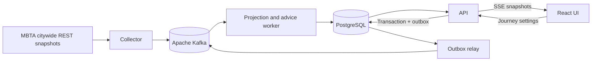

# HopAhead

**Know when your connection is getting away from you—and what to take next.**

HopAhead monitors a Boston transit journey from **Harvard → Park Street → Copley**. It compares live Red and Green Line predictions with published transfer allowances, explains a connection's remaining margin, and shows verified alternatives ranked by arrival at Copley.

The same decision function powers live advice and an interactive disruption replay. Every material recommendation retains the predictions, rule version, transfer data and evaluation time that produced it.

## What you can try

- Select a Red Line departure, set your extra transfer time, and pin a preferred Green Line connection.
- See both legs, transfer margin, relevant alerts, two alternatives and source freshness.
- Confirm you boarded to keep following the same trip after its origin prediction disappears.
- Inspect the evidence behind earlier recommendations.
- Play, pause and scrub simulated delay, cancellation, missing-data, stale-feed and recovery scenarios.

Live service varies with MBTA operations. Replay is explicitly simulated and remains useful outside service hours. HopAhead supports this curated corridor; citywide ingestion does not imply citywide routing.

## Run locally

Requires Docker with Compose and approximately 4 GB of available memory. No GPU or MBTA key is required.

```bash
git clone https://github.com/AniketKul/hopahead.git
cd hopahead
python3 - <<'PY'
import secrets
with open('.env', 'x') as f:
    f.write('POSTGRES_PASSWORD=' + secrets.token_urlsafe(32) + '\n')
    f.write('SESSION_SECRET=' + secrets.token_urlsafe(48) + '\n')
    f.write('PUBLIC_ORIGIN=http://localhost:3000\n')
PY
docker compose up --build -d
```

Open **http://localhost:3000**. The first citywide snapshot may take a minute. Use the same hostname as `PUBLIC_ORIGIN` when opening the app. Replay needs the API but does not need a fresh MBTA feed. `docker compose logs -f collector worker` shows ingestion and projection activity. `docker compose down` stops services while preserving their data volumes.

The default configuration binds the web endpoint to loopback. Database and broker ports are internal. This is a local/demo deployment; public hosting needs HTTPS, appropriate origin configuration and operational limits reviewed for the target host.

## How it works



Kafka captures bounded compressed snapshots. The collector sends chunks and then a completion manifest on one source partition. PostgreSQL activates only complete, validated snapshots, updating changed current rows rather than appending every unchanged prediction to a history table.

Workers commit receipt records and database effects together, then commit Kafka offsets. Retries are expected and idempotent. Producer idempotence and Kafka transactions do not make PostgreSQL writes globally exactly once. Source generations and revisions prevent old observations from replacing newer state.

PostgreSQL owns journey settings and decision evidence. A transactional outbox carries accepted settings changes to Kafka. Browser clients receive full versioned journey views and visibly age stale information when disconnected.

## Advice you can inspect

```text
margin = Green departure − Red arrival − published transfer minimum − personal extra time
```

At least 120 seconds beyond the allowance is “enough time”; 0–119 seconds is “tight”; a negative margin is insufficient. These are planning bands, not probabilities or guarantees. Predictions older than 90 seconds without refresh, or processing lag over 30 seconds, pause positive advice. Cancellation, skipped stops and missing evidence have distinct explanations.

The checked-in [transfer records](config/transfers.json) contain their official source, digest and feed version. Their minima already include MBTA's suggested buffer. Refresh them with `python3 scripts/import_transfers.py`; review the change and rerun tests before using a changed allowance.

## Development and checks

Node 22.22+ and Python 3 are supported for local development:

```bash
npm ci
npm test
python3 -m unittest discover -s tests -p 'test_*.py'
npm run build
```

Real-service integration checks use isolated projection schemas and temporary session-owned journeys. Start only infrastructure with:

```bash
docker compose -f compose.yaml -f config/compose.dev.yaml up -d postgres kafka
```

Set `DATABASE_URL` to your local PostgreSQL URL on port 55432 and `KAFKA_BROKERS=127.0.0.1:19092`, then run `npm run migrate` and `npm run test:integration`. Keep credentials in your shell environment, never Git. `npm run dev` starts Vite, which forwards `/api` requests to port 3000. Separate commands start `api`, `collector`, `worker`, and `relay`; the API also needs `SESSION_SECRET`. When browsing Vite, set the API's `PUBLIC_ORIGIN=http://127.0.0.1:5173` to match the browser address.

Browser checks: `npx playwright install chromium` then `npm run test:browser`. Screenshots, video and traces are disabled. See [verification](docs/verification.md) for the tests and measurements actually performed.

## Scope and limits

- One Kafka broker/controller and one PostgreSQL instance on one host. Persistent volumes support process restart, not host or disk loss.
- Three one-partition topics intentionally make source ordering explicit. Parallel worker scaling requires a measured partitioning change.
- Kafka deletion retention targets 24 hours with nominal budgets of 8 GiB for predictions and 1 GiB each for alerts/commands. These are per-partition policies, not a hard disk cap or guaranteed 24-hour replay window.
- Decisions are capped at 100 per journey and seven days; the UI loads the latest 30. Sessions expire after seven days. Stopping a watch deletes its journey history.
- No citywide route search, accessible walking guarantee, calibrated likelihood, GPS, ticketing, or mobile push notifications.

The [Boston scale study](docs/hopahead-boston-data-scale.md) separates measured citywide samples from extrapolations. The [design](docs/superpowers/specs/2026-11-05-hopahead-design.md) records the delivery, ordering and replay contracts inspired by *Designing Data-Intensive Applications*.
