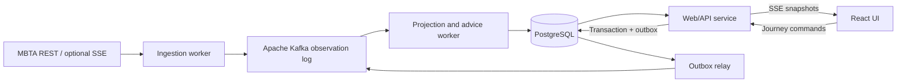

# HopAhead — first-release design

Status: initial implementation delivered. Apache Kafka is the selected broker. See the [verification record](../../verification.md) for functional checks, measured workloads and remaining limits; the acceptance list below describes the broader design targets.

## Intent and agreed decisions

HopAhead helps a transit rider decide whether a planned connection remains practical and which verified departure to take instead. Its explanations retain the evidence available when the advice was made.

The user selected the name HopAhead, GitHub owner `AniketKul`, Boston for the first release, a complete web UI, and Apache Kafka with separate workers. Ghostwork is a separate, deferred inference-debugging idea. The user explicitly requested a database choice grounded in DDIA and Boston-wide realtime data scale.

Implementation and GitHub publication were approved. Public deployment is separate from this local, single-host release.

## Product boundary

First working journey: Harvard → Park Street → Copley, using a rider-selected Red Line trip and an appropriate Green Line departure. This corridor has live predictions at both ends of each leg and published transfer allowances. Ingestion and capacity tests cover the broader MBTA feed; supported routing remains explicitly limited to the curated corridor initially.

The rider can select an incoming departure, add personal transfer time, pin a preferred outgoing departure, and see two verified alternatives. Advice may identify a different Green Line branch when that particular trip serves Copley. The app never infers service solely from a branch name.

The first release is a runnable, single-host open-source app with live and replay modes. It does not promise citywide journey planning, calibrated connection probabilities, automatic location tracking, accessible routing, ticket purchases, background mobile notifications, or host-failure availability. No GPU is needed for the core product.

## Approaches considered

1. A single service with a durable database event log: lower operational cost, adequate for the core application, but a smaller messaging demonstration.
2. A message broker with independent ingestion and processing workers: explicit delivery, backpressure, redelivery, and worker-recovery boundaries; additional operational components.

The user selected approach 2 and explicitly chose Apache Kafka. Implementation: TypeScript throughout; React web client; Node API and workers; Apache Kafka for retained source observations; PostgreSQL for application-owned data and derived serving state. Use Kafka in KRaft mode without ZooKeeper. Pin stable server and compatible client versions during implementation planning; do not assume local Node 22 is the intended deployment version. Kafka Streams is not required for the Node workers.

## Rider interface

- Responsive journey setup with Harvard → Copley clearly identified, incoming departure selection, and an editable additional-transfer-time allowance.
- Journey view showing both legs, predicted times, required transfer allowance, remaining margin, source health, and a plain-language recommendation.
- Alternative departures ranked by predicted destination arrival when all required evidence exists. Show why an option is unavailable or too tight.
- A history of material recommendation changes with the exact relevant predictions, allowance, and rule version. Keep database/broker internals out of the rider's main view.
- A separate replay view with play, pause, scrub, and named disruption scenarios. It is visibly marked as replay/simulated data and cannot modify live state.
- Keyboard operability, screen-reader labels, non-color status indicators, readable contrast, and restrained live announcements. An optional route schematic does not depend on paid map tiles.

A disconnected browser must visibly age its displayed information using the snapshot timestamp; a green-looking frozen page is not an acceptable failure mode.

## Verified MBTA contract

Research date: November 5, 2026. These stop identifiers are verified source data, not evidence of future service availability.

| Location | Parent station | Platform and direction |
|---|---|---|
| Harvard, Red departure | `place-harsq` | `70067`, direction 0 South |
| Park Street, Red arrival | `place-pktrm` | `70075`, same incoming trip |
| Park Street, Green departure | `place-pktrm` | B/C/D/E: `70196/70197/70198/70199`, direction 0 West |
| Copley, Green arrival | `place-coecl` | `70155`, same outgoing trip |

The verified corridor query is `/predictions?filter[route]=Red,Green-B,Green-C,Green-D,Green-E&filter[stop]=place-harsq,place-pktrm,place-coecl&filter[direction_id]=0&include=trip,stop`. For each leg, join endpoints by trip ID and increasing stop sequence. A vehicle ID is insufficient because a vehicle operates multiple trips.

The November 4 GTFS feed gives Park Street transfer minima of 152 seconds from `70075` to B/D and 184 seconds to C/E. These totals already include the published 90-second suggested buffer. Import and version the source transfer records; do not silently double-count the buffer. Add the user's personal extra allowance separately. Display this as a planning allowance, not a guaranteed or accessible walking time.

V3 `schedule_relationship` values include `CANCELLED`, `SKIPPED`, and `NO_DATA`. Cancellation or skipping the relevant endpoint disqualifies that departure. Missing data means unavailable/unknown; an item disappearing from a snapshot is not evidence it was canceled. `status` text is displayed safely and must not be parsed as an unverified control protocol.

Rail uncertainty fields encode agency-specific operating states, not calibrated probabilities. Preserve and explain those quality categories. The live serializer uses `revenue` while Swagger describes `revenue_status`; rely on the documented revenue-service filter and accommodate observed payload fields without rejecting valid data.

Store timestamped instants in UTC and render journey times in `America/New_York`. Keep GTFS service date distinct from calendar date. After-midnight services and daylight-saving transitions require explicit tests.

Fetch alerts separately. Match active periods and informed entities to relevant route, trip, direction, stop, and activity. A closure beyond Copley must not invalidate a trip ending at Copley. Unstructured alerts can warn without inventing a machine-verifiable routing constraint.

## Source transport and freshness

Start with centrally polled REST snapshots: predictions every 15 seconds and alerts every 60 seconds. All browser clients share this ingestion. Cache static metadata and transfer records. Follow pagination before declaring a snapshot complete and respect rate-limit reset/retry headers. The observed anonymous budget is 20 requests/minute per IP; the planned cadence needs re-evaluation if pagination increases request count.

Keyed MBTA SSE is an optional transport upgrade, not a prerequisite for running the app. It requires a user-provided key. `reset` replaces a collection, `add/update` replace resources, and `remove` identifies resources to remove. Included related resources do not automatically receive subsequent live updates. Both adapters must normalize into the same complete-snapshot/change-set contract.

Track successful source contact, HTTP collection `Last-Modified`, observation receipt time, broker capture time, and projection time separately. Prediction arrival/departure estimates are not event version timestamps. No per-prediction observation timestamp is available, so the app must not claim to know the exact age of the underlying measurement.

Initial application policy: after 90 seconds without a successful prediction refresh/revalidation, mark source connectivity stale and stop positive connection advice. Expose projection lag independently. A successful unchanged response may revalidate the collection but cannot prove every prediction is recent. Arrival times that have elapsed are not future boarding opportunities.

## Streaming architecture and authority

Authority is explicit:

- MBTA remains the external authority. HopAhead records observations; polling cannot capture every upstream transition.
- Kafka is the authoritative captured feed log within its advertised retention window. The collector does not independently dual-write raw feed history to PostgreSQL.
- PostgreSQL owns journey settings and durable recommendation/evidence records. Current transit tables are derived from the observation log.
- Journey changes and their outgoing events use a PostgreSQL transactional outbox. Publish acknowledgment may be lost, so duplicates are expected.
- Decision records retain the exact bounded input facts, transfer-data version, rule version, evaluation instant, and source cursors needed to explain or reproduce that decision. They are not a second complete raw-feed archive.

Use persistent Kafka logs, standard consumer groups, idempotent producers with `acks=all`, and disabled consumer auto-commit. Consumers commit the next offset only after the corresponding PostgreSQL transaction commits. Producer idempotence handles producer retries; it does not deduplicate an outbox event republished after relay restart. Kafka transactions do not atomically include PostgreSQL writes. Stable application event IDs and transactional receipts provide idempotent committed database effects under redelivery, not globally exactly-once execution.

Start with separate `hopahead.mbta.predictions.v1`, `hopahead.mbta.alerts.v1`, and `hopahead.journey.commands.v1` topics, one partition each. Raw-feed records use a stable source key; commands use the journey ID. All chunks and the completion manifest for a source remain on the same partition, in publication order. Separate consumer groups provide independent replay/processing; workers within one group divide partitions rather than broadcast. More workers cannot parallelize one partition. Measure before changing this topology; increasing partition counts requires an explicit ordering migration. There is no global order across topics. Decision evidence records the source generation/revision and relevant topic/partition/offset positions separately.

## Snapshot publication and ordering

Measured whole-city JSON snapshots are approximately 10 MB raw. Compress captured snapshots and split the compressed representation into chunks no larger than 256 KiB; do not depend on a whole-city payload always fitting one Kafka record batch. Size encoded envelopes and producer batches within configured producer request, broker/topic record-batch, and consumer fetch limits. Enforce decompressed-size and resource-count bounds before allocation and parsing.

Publish bounded compressed chunks with stable message IDs, snapshot identity, collector generation, source identity, observation time, encoding, chunk index/count, schema version, and content digest. Publish a completion manifest on the same source partition only after every chunk receives a successful `acks=all` produce response. This acknowledges the required in-sync replicas; it does not promise per-record disk flush or redundancy on a single broker. A worker stages chunks idempotently and activates the complete snapshot in one database transaction after manifest/count/digest validation. Staging data is temporary and removed after activation or expiration; it is not a second raw archive.

Incomplete snapshots never delete current resources or appear as current state. A collector restart opens a new generation with a full baseline. Permit only one active collector per source in the first deployment; acquisition and writes must be guarded through one verified ownership session, and losing that session stops the collector. Automatic multi-host failover is outside the first release.

Use ordered observed snapshots, not ETA values, as replacement versions. Reject duplicate/obsolete generations and snapshot revisions. Where MBTA supplies no entity event version, late evidence is labeled as a late observation rather than falsely assigned an exact real-world ordering.

The first release records complete compressed snapshots, avoiding a fragile retained-delta chain. Derive additions/changes/removals against the last complete snapshot and update only changed serving rows. Separate unchanged-source health checks from entity writes. Baseline-plus-delta archival is a later optimization only if measured retention costs justify it; it must preserve a usable baseline and every required delta. Deleted resources are removals from current prediction state, not synthesized cancellation facts.

## Transaction and recovery rules

For each consumed record, update the stable-message receipt and staging/projection changes in the same PostgreSQL transaction, then commit its next Kafka offset. A crash before the database commit leaves no effect; a crash after the database commit but before the offset commit is a deduplicated retry. Process each partition sequentially and never commit past unfinished earlier records. Snapshot completion and current-pointer advancement are atomic. Serialize source-pointer changes and per-journey revisions with database locks so overlapping workers during a rebalance cannot regress state; stop work on revoked partitions and reject obsolete source generations/revisions.

Treat offsets outside retained history as explicit gaps. Configure the client's equivalent of `auto.offset.reset=none` for established processing and handle first bootstrap separately. Do not silently reset to the latest offset and claim recovery. Mark the source stale, find a complete retained snapshot or request a fresh baseline, and only then resume serving refreshed advice. Validate this path alongside consumer-group rebalances and worker crashes.

Journey commands carry an idempotency key scoped to their owner. A uniqueness constraint and transaction couple command acceptance, settings revision, and outbox insertion. The relay may retry publication; downstream consumers use the stable event ID.

The first advice worker serializes updates per monitored journey and increments its revision inside the committing transaction. Do not treat a PostgreSQL sequence value allocated before commit as a gap-free commit-order cursor. The UI receives full versioned journey snapshots, discards older revisions, and fetches current state after reconnect. Live notifications are wakeups; PostgreSQL is the recovery source for current UI state.

Malformed records go to an inspectable quarantine with bounded retries; persist the quarantine decision before advancing their offsets. If missing or quarantined records prevent a complete snapshot, keep prior state visibly aging and request a fresh baseline. Do not silently skip a broken feed event and claim the new snapshot is complete.

## Advice rules

Pin the rider-selected incoming trip. Disappearance of its origin departure must not silently put the rider on another train. Permit explicit rider progress updates and trip reselection.

For each candidate outgoing trip with valid Park departure and Copley arrival evidence:

`margin = outgoing_departure - incoming_Park_arrival - versioned_transfer_minimum - personal_extra_time`

Expose the numerical margin. Negative margin means insufficient planned transfer time. Rank eligible alternatives by predicted destination arrival, not simply earliest boarding. Use a stable tie-breaker so equivalent updates do not produce visual churn.

Initial display policy: a margin of at least 120 seconds beyond the transfer allowance is `enough_time`; 0 through 119 seconds is `tight`; a negative margin is `insufficient_time`. These are disclosed planning bands, not statistical confidence. Cancellation/skip gives `unavailable`; missing evidence gives `unknown`; stale source or excessive processing lag gives `stale` and overrides positive advice. Keep this policy versioned in one rule module and test exact boundaries. Do not call an estimate guaranteed or assign a percentage chance of success.

The advice function is pure over a captured input snapshot, explicit evaluation time, transfer version, and rule version. Clock-driven expiration must be recorded in evaluation inputs; replay must not consult today's clock or current transfer data. Persist a new decision when its meaningful advice/evidence changes, rather than every browser refresh or countdown second.

## Database workload and retention

PostgreSQL is proposed for bounded current state, relational trip-stop joins, journey settings, idempotency, and decision evidence. Use typed identity/time/status columns with modest B-tree indexes; preserve only needed extension fields as JSONB. Avoid updating unchanged rows and avoid blanket indexes over raw payloads.

The [Boston-wide scale assessment](../../hopahead-boston-data-scale.md) measured five complete snapshots at 15-second intervals: 17,284–17,575 predictions, about 10.1 MB raw/0.58 MB gzip per snapshot, and approximately 313 net resource deltas per second. The multiweek static GTFS feed contains 2.86 million stop-time rows. These are late-evening measurements, not a peak or database capacity test.

At a constant extrapolation of that sample, full prediction snapshots would occupy 58.13 GB/day raw or 3.34 GB/day gzip before broker/storage overhead. Full entity history would generate about 100.4 million rows/day; do not implement that in PostgreSQL. Current state and application-owned decisions remain appropriate PostgreSQL candidates. Distinguish source observations per second, changed resources per second, consumer writes, archive bytes, active journeys, and connected browsers. API HTTP request rate is not resource-update rate.

Initial Kafka retention proposal: `cleanup.policy=delete`, `retention.ms=86400000`, and a nominal 10 GiB sum of `retention.bytes` allocations across the initial topics/partitions. Allocate 8 GiB to the prediction partition and 1 GiB each to alerts and commands. These are per-partition settings, not a cluster-wide hard disk cap. Start with 64 MiB segments and a 15-minute segment-roll setting, then measure actual retention behavior. Segment deletion is asynchronous; active segments, indexes, internal topics, replicas, and deletion delay require additional disk headroom and capacity alerts. Keep raw snapshots uncompacted: compaction by source key would remove chunks/history needed for replay.

Verify the retention budget against measured broker bytes before calling it a 24-hour replay service. Effective history may be shorter when size-based deletion applies. Whole snapshots are independently reconstructible, but only a complete set of chunks plus manifest is replayable; segment deletion can remove only part of a snapshot. Advertise the earliest complete snapshot, not merely the earliest retained offset. Require the source snapshots/versions used by a historical decision or use its separately retained exact evidence. Detect retention gaps and never silently present a discontinuous sequence as complete history.

Long-term whole-city raw history, if required, belongs in compressed immutable archive segments with manifests/checksums and a stated retention policy. It is not an unbounded JSONB history table. The first release must ship a small deterministic fixture bundle so a public demo does not depend on keeping live history forever.

## Security and deployment

One CPU host runs web/API, ingestion, processing, outbox relay, PostgreSQL, and Apache Kafka using a documented Compose setup. The first local/demo profile uses one combined KRaft broker/controller with replication factor 1 and `min.insync.replicas=1`, including appropriate internal-topic replication settings. This is a single-host demonstration, not a highly available deployment. `acks=all` still means only one replica in this profile. Private networks isolate database/broker ports; only the app endpoint is exposed. Persistent volumes preserve broker/database state across process restart; they do not establish survival of disk or host loss. Future availability requires replicas and controllers across independent failure domains, not additional containers on the same host.

Use environment-provided secrets and parameterized SQL. Browser journey state is scoped to an opaque, signed session; enforce ownership server-side on reads and writes. Bound sessions, watches, payload sizes, and SSE buffers. Never accept arbitrary upstream URLs from clients. No API keys reach browser bundles, logs, fixtures, or Git history.

Development logs are verbose and structured with observation/message/journey IDs, but redact secrets and avoid storing unnecessary rider data. A public deployment requires HTTPS, origin/CSRF controls for mutations, resource limits, and an explicit retention/deletion policy for sessions. Public deployment is a later authorized step, not implied by this design.

## Acceptance and validation

1. Live end-to-end flow: select a currently available incoming trip and see verified current alternatives with matching endpoint trip identities.
2. Replay end-to-end flow: deterministic scenarios for delay, cancellation, disappearance, stale feed, and recovery; every recommendation explains its source inputs.
3. Delivery faults: duplicate chunk, missing chunk, duplicate manifest, obsolete revisions, consumer-group rebalance, and a worker crash after DB commit/before offset commit cannot duplicate committed decisions or expose a partial snapshot. Out-of-order processing is injected as a failure test; Kafka ordering is partition-scoped.
4. Recovery: restart Kafka and workers with persistent volumes; restore current state. An offset outside retention or a replay request older than the earliest complete retained snapshot is rejected or recovered via an explicit fresh baseline, never silently skipped.
5. Time: service-day rollover, DST boundaries, expired departures, and stale browser state receive focused tests.
6. UI: automated browser checks for journey selection, live update, fallback explanation, replay controls, narrow-screen layout, and keyboard flow. Do not capture screenshots without user permission.
7. Capacity: benchmark the actual normalized citywide workload and a deliberately amplified stress workload. Measure ingestion lag, oldest pending message, projection latency, p95/p99 API latency, disk/WAL growth, and memory while checkpoints/autovacuum and normal reads run. Report observed results separately from targets and extrapolations.

## Delivery order

First pin the design and source/schema contract. Then implement the advice function and deterministic fixtures, the broker-to-database failure-safe path, the complete UI/replay flow, and live ingestion. Finish with measured citywide-load and fault tests, documentation, and a reviewable GitHub publication under `AniketKul`.

## Primary references

- Martin Kleppmann and Chris Riccomini, Designing Data-Intensive Applications, second edition: delivery semantics, derived state, bounded retention, and replay inform this design.
- [MBTA V3 schema](https://api-v3.mbta.com/docs/swagger/swagger.json)
- [MBTA V3 best practices](https://www.mbta.com/developers/v3-api/best-practices)
- [MBTA V3 streaming](https://www.mbta.com/developers/v3-api/streaming)
- [MBTA GTFS](https://cdn.mbta.com/MBTA_GTFS.zip)
- [MBTA transfer definitions](https://github.com/mbta/gtfs-documentation/blob/master/reference/gtfs.md#transferstxt)
- [Apache Kafka delivery semantics and external-system transactions](https://kafka.apache.org/42/design/design/)
- [Kafka producer acknowledgments and idempotence](https://kafka.apache.org/42/configuration/producer-configs/)
- [Kafka consumer offset configuration](https://kafka.apache.org/42/configuration/consumer-configs/)
- [Kafka topic retention and record-batch limits](https://kafka.apache.org/42/configuration/topic-configs/)
- [Kafka KRaft deployment](https://kafka.apache.org/42/operations/kraft/)
- [PostgreSQL JSON types](https://www.postgresql.org/docs/current/datatype-json.html)
- [PostgreSQL partitioning](https://www.postgresql.org/docs/current/ddl-partitioning.html)
